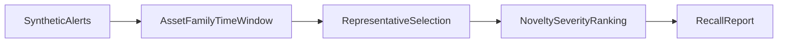

1. Cluster and dedupe security alerts, rank by novelty and risk, cut noise measurably.

2. Result:
   Input synthetic alerts: 700  
   Alert volume reduction: 85.57142857142857 percent  
   True-positive incident recall: 0.9411764705882353  

   Measured with `make bench`: [raw results](evidence/bench.json), [command output](evidence/checks.log), [environment](evidence/environment.json).

3. Architecture:


4. Run it:
```sh
make setup
make lint test bench
make demo
```

5. Decisions and limits: Synthetic security alerts only. Dedupe uses observable asset/family/time signatures and severity, never ground-truth labels or incident IDs. Reported recall is distinct labeled true-positive incident recall; raw positive-alert retention is separately recorded in bench.json so duplicate suppression is not mistaken for retaining every positive alert. A deliberately colliding pair of distinct incidents exposes a false merge; evidence/collisions.json retains the missed event. Novelty is inverse batch frequency, not a calibrated threat score. No production detection or threat-intelligence claims.

6. Next: Tune time windows on independent labeled simulations and preserve candidate incident splits for reviewer feedback.
