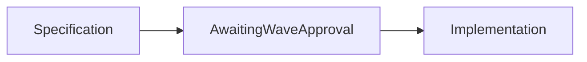

1. Cluster and dedupe security alerts, rank by novelty and risk, cut noise measurably.

2. Result:
   Acceptance: not measured  
   Performance: not measured  
   Correctness: not measured

3. Architecture:

4. Run it:
No runnable implementation yet. This is a planned Wave 3 project.

5. Decisions and limits: Public repository reserved for independent work using public or synthetic data. Implementation has not started. No company affiliation or usage is claimed. Acceptance check: Alert volume reduced by X percent at Y percent recall of true positives.

6. Next: Implement after approval for Wave 3, then run and publish the required acceptance commands.
